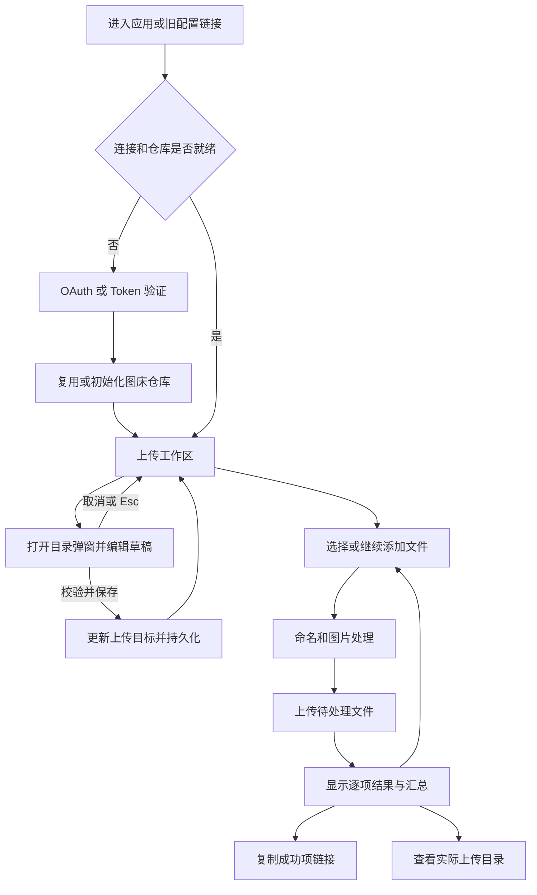
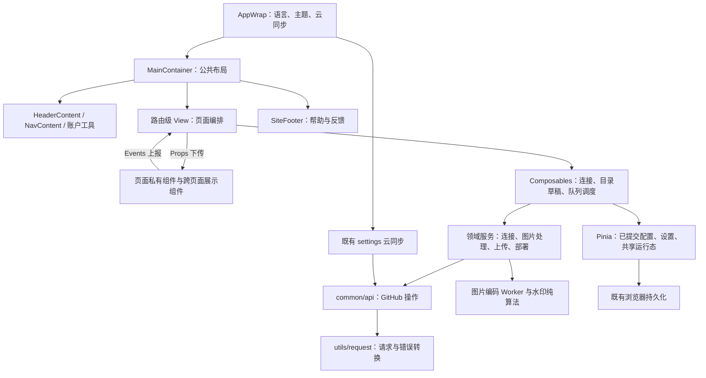
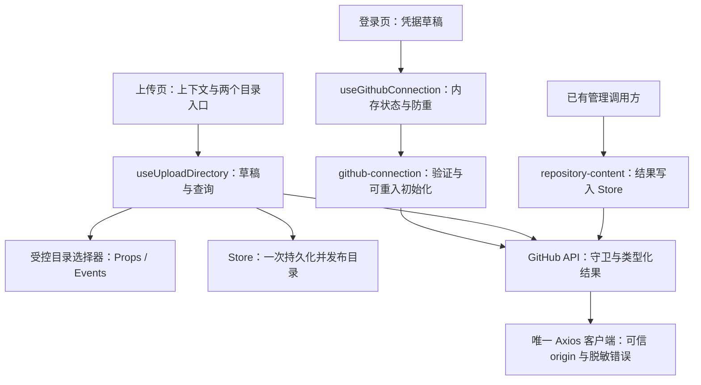

# PicX · GitHub 图床 UI 升级改造方案

| 项目 | 内容 |
| --- | --- |
| 文档版本 | V1.0 |
| 编写日期 | 2026-10-16 |
| 设计依据 | [新版 UI 设计稿](UI/picx-ih.pen) |
| 适用项目 | PicX · GitHub 图床，当前 `picx-ih` 仓库 |
| 当前状态 | P0 基线与契约已完成；P1–P6 未开始，实施证据见 [验收记录](UI-REDESIGN-ACCEPTANCE.md) |

## 1. 改造目标与范围

本次将现有侧边栏工作台升级为新版胶囊顶栏与内容工作区，保留 GitHub 图床的登录、上传、管理、图片处理、链接生成和部署能力。

**原“图床配置”页面合并到“上传图片”页面，不再保留独立导航入口。** 合并后的职责分配为：

- 登录页：OAuth 授权、Token 输入与验证、账户连接、仓库初始化。
- 上传页：展示当前仓库、分支与连接状态，配置上传目录，管理待上传文件、快捷设置和上传结果。
- 图床设置页：维护命名、压缩、水印、链接规则、默认复制格式、Pages 与域名等长期偏好。

“图床配置”和“图床设置”是不同功能。前者取消独立页面，后者继续作为 `/settings` 页面存在。

本次必须交付：

1. 与设计稿对应的登录、上传、图片管理、图床设置页面。
2. `/config` 旧链接及登录回调兼容，确保旧入口能够完成原有流程。
3. 目录弹窗的草稿、保存、取消、校验与异常恢复。
4. 图片与 MP4 上传、压缩、水印、复制、管理和部署的完整状态反馈。
5. 简体中文、繁体中文、英文，以及亮色、暗色和系统主题的适配。
6. 最低 375px 的响应式布局与键盘操作支持。

本期不安排技术栈大版本升级、Pinia 二次迁移、图片工具插件平台、多仓库切换、全仓库递归搜索或新的服务端。继续使用当前 Vue、Element Plus、Stylus、GitHub API 与图片编码 Worker。图床设置的现有能力不能因画稿未展示而被移除。

## 2. 核对依据与当前基线

### 2.1 核对范围

设计稿通过 Pencil 工具读取，已核对全部 11 个顶层画板的结构、文字、变量与截图，以及“当前仓库与连接状态”复用组件。以下节点 ID 用于实施时准确定位，节点发生变化后应重新核对设计稿。

| 画板 | 节点 ID | 实施对应 |
| --- | --- | --- |
| 00 / PicX 设计系统与产品规则 | `Zo7cz` | 品牌、语义色、字体与基础控件 |
| 01 / PicX 图床 / 登录 | `DZzo7` | 双登录卡片、Token 表单、连接引导、页脚 |
| 02 / PicX 图床 / 上传图片 / 空状态 | `O9DRIk` | 仓库上下文、拖放入口、快捷设置 |
| 02.1 / PicX 图床 / 上传图片 / 配置目录弹窗 | `Bi2Sk` | 目录弹窗、仓库目录逐级选择 |
| 02.2 / 目录配置 / 模式与交互状态 | `SLz4l` | 四种目录模式、校验、加载、空与失败状态 |
| 02.3 / PicX 图床 / 上传图片 / 已选择待上传 | `OL0pP` | 待上传队列、继续添加、数量与体积 |
| 02.4 / PicX 图床 / 上传图片 / 已上传已压缩 | `dFSNj` | 上传完成反馈、压缩前后体积、复制全部链接 |
| 03 / PicX 图床 / 图片管理 / 根目录 | `YxFJA` | 文件夹列表与根目录无图片状态 |
| 03.1 / PicX 图床 / 根目录 / 文件夹与图片共存 | `EAM8q` | 文件夹、直属图片分区与图片卡片 |
| 03.2 / PicX 图床 / 目录内图片 / 批量选择 | `UUeb5` | 面包屑、搜索、批量选择、复制与删除 |
| 04 / PicX 图床 / 图床设置 | `M0qx2A` | 上传处理、链接与分享、部署与域名 |
| 当前仓库与连接状态组件 | `lA2S0`，顶层实例 `cOfT3` | 仓库、分支、上传目标与真实连接状态 |

画稿中的 `XPoet`、`main`、`2025/08`、文件名、数量和体积均为样例，页面应显示实际数据。当前源码初始化分支常量为 `master`，不得直接用画稿的 `main` 覆盖用户配置。

### 2.2 技术与工程事实

以下为本次读取 `package.json`、`pnpm-lock.yaml` 和源码后的事实，不代表检查已经执行通过。

| 项目 | 当前事实 | 对方案的影响 |
| --- | --- | --- |
| 状态管理 | 已使用 Pinia，`src/stores/index.ts` 保留 Vuex 风格的兼容门面 | 不安排 Vuex → Pinia 迁移；新逻辑使用明确类型的 action |
| 锁文件版本 | Vue 3.5.40、Pinia 4.0.2、Vue Router 5.2.0、Element Plus 2.14.3、Vue I18n 11.4.8、Vite 8.2.0、TypeScript 6.0.3 | 沿用现有依赖；这些是锁定版本，不是对本机安装结果的声明 |
| 运行环境 | `engines.node` 为 `>=24 <25`，`.node-version`、`.nvmrc` 为 24，包管理器为 pnpm 11.18.0 | 实施验证遵循仓库约束，不混用 npm 或 yarn |
| 路由 | Hash 路由；`/` 为登录页，另有 `/config`、`/upload`、`/management`、`/settings`、`/feedback` | 保持 Hash 部署方式，补全旧入口兼容 |
| 工程脚本 | 已有 `typecheck`、`test`、`test:e2e`、`verify` | 直接使用现有脚本并补充业务场景覆盖 |
| 图片处理 | 压缩经 `src/services/image-codec.ts` 调用 Worker；水印已有独立算法 | 复用算法，只调整调度与展示边界 |
| 图床设置 | 已支持时间戳命名、水印平铺、链接来源、排序、自定义域名和 `.settings` 云同步 | 以现有模型承接新界面，防止功能丢失 |

`AGENTS.md` 中关于 Vuex、无正式测试脚本的描述已落后于源码。本文以当前代码为实施基线，不把已有能力列为待从零建设的任务。其引用的技术升级与插件平台方案在当前 `docs` 中未发现，本次 UI 改造不依赖这些文件。

### 2.3 现有代码与改造落点

| 模块 | 当前入口 | 需要解决的问题 |
| --- | --- | --- |
| 应用布局 | `views/main-container`、`components/header-content`、`components/nav-content` | 从侧栏改为顶栏，调整页面滚动与窄屏布局 |
| 登录与初始化 | `views/picx-login`、`views/picx-config/picx-config.util.ts` | Token 输入仍在配置页；授权成功仍进入配置页 |
| 上传 | `views/upload-image`、`components/getting-images`、`utils/upload-utils.ts` | 缺少右侧设置；处理任务依赖卡片挂载；完成后缺少统一结果区 |
| 目录配置 | `views/picx-config`、`components/repo-dir-cascader` | 当前直接修改 Store 并持久化，不能直接用于可取消的弹窗 |
| 图片管理 | `views/imgs-management`、`utils/repo-content-utils.ts` | 增加搜索和面包屑；选择框与部分操作依赖 Hover 或右键 |
| 设置 | `views/picx-settings`、压缩、水印、链接规则组件 | 折叠面板改为三个设置分区，保留既有选项 |
| 部署 | `components/deploy-status-bar`、`common/api/branch.ts`、`common/api/deploy.ts` | 两个页面共享执行状态；现有固定等待时间不能证明站点可访问 |
| 持久化 | `stores/picx-store.ts`、`utils/storage.ts`、`use-cloud-settings-sync.ts` | 保留旧键、旧字段与云同步范围，区分表单草稿和已保存配置 |

编写方案时工作区已有导航、顶栏、头像、多语言和登录样式改动；P0 开始时这些改动已提交，工作区干净，详见验收记录。后续实施应在现有实现基础上逐项整合，不能重置或覆盖。旧配置页相关文件在迁移期保留，不将物理删除文件作为本方案的实施步骤。

## 3. 信息架构与路由迁移

### 3.1 新导航

桌面顶栏按画稿呈现品牌、首页、上传图片、图片管理、图床设置，以及语言、主题、通知和账户入口。通知复用现有站点公告能力，不新增消息后台；PWA 能力继续保留，安装入口仅在浏览器支持且可安装时放入账户工具菜单。

| 入口 | 路由与行为 |
| --- | --- |
| 品牌 / 首页 | `/#/?jump=0`，显示连接引导页；本期不新增营销首页 |
| 上传图片 | `/#/upload`，主要工作入口；缺少连接时在页内给出连接入口 |
| 图片管理 | `/#/management`；未连接时提供明确引导，不能再跳到已合并的配置页 |
| 图床设置 | `/#/settings`；无可用仓库时允许解释设置含义，禁用需要远端写入的操作并说明原因 |
| 意见反馈 | 保留 `/#/feedback`，从页脚或帮助菜单进入 |
| 开始使用 | 仅未登录时展示，前往连接页；已登录时以账户入口承接 |

登录页画稿包含账户样例，其他画板同时出现“开始使用”和账户样例。实施按真实登录态互斥显示，不能展示虚构身份。连接状态必须由验证结果驱动，不能只凭本地存在 Token 显示“GitHub 已连接”。

P1 的账户重连 / 登出统一进入 `/?jump=0&returnTo=<path>`。`returnTo` 只允许 `/upload`、`/management`、`/settings`、`/config` 的应用路径，缺省为 `/upload`，不携带原 URL query、账户对象或凭据，不另存浏览器状态。P1 保留恢复目标，P2 T015 在连接初始化与旧路由迁移时统一消费该目标；不得将任意外部 URL 用作重定向。

### 3.2 旧入口兼容

`/config` 改为兼容入口，不再渲染独立配置页面。不能仅增加一个静态 `redirect` 就认定合并完成，必须覆盖以下情况：

| 原入口 / 触发点 | 新行为 |
| --- | --- |
| 已有完整配置访问 `/#/config` | `replace` 到上传页，保留已保存目录，不重复初始化仓库 |
| 无有效连接访问 `/#/config` | 前往连接页，成功后回到上传页 |
| `/#/config?auto=1` | 交由连接初始化流程处理；完成后进入上传页并消费该标记，刷新不能重复创建仓库 |
| `/#/config?focus=1` | 打开连接页并聚焦 Token 输入；不把 Token 放进 URL |
| 上传校验发现未连接 | 显示连接恢复入口，成功后返回原上传工作区 |
| 上传校验发现未配置目录 | 在上传页打开目录弹窗 |
| 目录栏原“前往配置”操作 | 直接打开目录弹窗 |
| 头像、授权失效提示中的 `/login` | 统一使用真实登录路由 `/`；可增加 `/login` → `/` 的兼容跳转 |

修改范围包括路由、导航配置、登录页初始化、OAuth 回调、上传校验、目录栏、授权提示与两个现存头像组件。对 `/config` 和 `/login` 的检索必须区分应用路由与外部文档 URL，不能误改教程地址。

### 3.3 主流程



## 4. 公共布局与设计系统

### 4.1 布局基准

| 元素 | 设计稿基准 | 实施要求 |
| --- | --- | --- |
| 桌面画板 | 1440px；主要业务画板高度 1080px | 作为视觉比对尺寸，不固定浏览器页面高度 |
| 顶栏 | 高 72px，外侧上边距 24px、左右 32px，圆角 40px | 使用真实导航与按钮，内容不足时按断点调整 |
| 主内容 | 1440px 下左右各 88px，即内容宽 1264px | 内容居中，最大宽度 1264px，窄屏使用弹性边距 |
| 仓库上下文 | 上传页顶栏下方，高 60px | 长仓库名和路径可换行或展开查看，不能撑宽页面 |
| 上传快捷设置 | 宽 320px，内边距 24px，圆角 20px | 宽屏位于右侧；可吸附，但不能遮挡页脚或操作 |
| 拖放空态 | 高 408px，圆角 24px | 中低高度窗口和手机上允许缩短，不挤出主操作 |
| 待上传队列 | 宽 244px；行高 64px | 48px 缩略图、文件名、体积与状态 |
| 已上传队列 | 宽 352px；行高 78px | 容纳压缩前后体积与复制动作；窄屏统一收紧宽度 |
| 目录弹窗 | 宽 760px，圆角 20px | 宽度不超过视口减 32px，内容区可滚动，底部按钮可见 |
| 设置页 | 三个分区，分区间距 40px，双卡片间距 24px | 内容决定高度，不能复制画稿固定卡片高度导致翻译被裁切 |

采用页面主滚动区承载长内容，队列和弹窗在需要时独立滚动。改造现有 `height: 100%`、多层 `overflow` 与侧栏占位时，应明确每层滚动职责，避免出现整个页面、内容容器、卡片同时滚动的情况。

### 4.2 语义 Token

颜色取自设计稿变量，统一映射为 `--picx-*` CSS 变量，并同步 Element Plus 主题变量。原始色值集中放在主题文件，业务组件只引用语义名称。

| 建议 Token | 设计变量 | 亮色值 | 用途 |
| --- | --- | --- | --- |
| `--picx-color-brand` | `brand-blue` | `#4D79C7` | 品牌展示 |
| `--picx-color-brand-accent` | `brand-green` | `#62CD94` | 标志渐变，不用于正文 |
| `--picx-color-primary` | `blue` | `#416AAF` | 主按钮、链接、选中态 |
| `--picx-color-primary-hover` | `blue-hover` | `#315DA3` | 主操作 Hover |
| `--picx-color-primary-soft` | `blue-soft` | `#EAF1F8` | 轻量选中背景 |
| `--picx-color-text` | `ink` | `#183443` | 正文和标题 |
| `--picx-color-text-muted` | `muted` | `#536874` | 辅助文字 |
| `--picx-color-bg` | `bg` | `#F5F8FA` | 页面背景 |
| `--picx-color-surface` | `surface` | `#FFFFFF` | 卡片和浮层 |
| `--picx-color-border` | `line` | `#DCE5EB` | 分隔边框 |
| `--picx-color-control-border` | `control-border` | `#81919C` | 需要明确轮廓的控件 |
| `--picx-color-success` | `green` | `#168264` | 成功文字与图形 |
| `--picx-color-connected` | `ih-success` | `#127A5D` | 连接状态 |
| `--picx-color-success-soft` | `success-soft` | `#EAF6F0` | 成功反馈背景 |
| `--picx-color-warning` / `--picx-color-warning-soft` | `warning` / `warning-soft` | `#8A5B12` / `#FFF7E8` | 风险提示 |
| `--picx-color-danger` / `--picx-color-danger-soft` | `danger` / `danger-soft` | `#B04444` / `#FFF1F0` | 错误与危险操作 |
| `--picx-color-focus` | `focus` | `#4D79C7` | 键盘焦点环 |
| `--picx-color-overlay` | `dir-overlay` | `#18344366` | 模态遮罩 |

画稿只定义了亮色页面和深底品牌示例，没有完整暗色业务画板。暗色继续保留，通过同一语义 Token 适配并单独检查对比度，不将品牌深底示例当作完整暗色规范。

间距采用 4、8、12、16、20、24、28、32、40、48px 的有限集合；圆角按控件、卡片、弹窗、顶栏角色管理。动画使用 150–300ms 的 `transform` / `opacity`，减少动态效果时关闭非必要动画。

### 4.3 字体、图标与旧样式过渡

- 中文参考 Noto Sans SC，英文与数字参考 Manrope；品牌字标使用设计稿已转曲矢量。字体资源和授权尚未作为本方案交付，实施时优先使用本地合法资源及系统回退，不能直接新增远程字体请求。
- 字级参考设计系统的 40、30、20、14、12px。正文与关键说明至少 14px，12px 仅用于非关键辅助信息；移动端关键输入至少 16px。
- 设计稿图标统一为 Lucide，现有代码为 Iconify 的 Element Plus 图标集。新版业务界面统一迁移为设计稿所需的 Lucide 图标，默认使用本地 SVG 与统一图标组件，不增加运行时依赖；保留来源与许可信息。组件库内部图标沿用组件库实现。
- 不手绘替代品牌标志，不用 Emoji 替代导航、状态或操作图标。
- 当前根字号是 `1px`，并在小屏继续缩小，历史样式大量使用 `rem`。新版尺寸使用明确的 CSS Token 和实际像素值，在新布局范围内建立字号基线；不能直接将全局根字号改为 `16px`，导致旧页面和工具组件被放大。
- 主题桥接先兼容现有 `--background-color`、`--text-color` 等变量，分阶段替换。只有完成全部引用核对后才能停止使用旧变量。

## 5. 登录与原图床配置能力迁移

### 5.1 登录页面

按照 `DZzo7` 实现连接引导、三步说明、OAuth 与 Token 两张等宽卡片，以及凭据保存提醒。

| 登录方式 | 行为与状态 |
| --- | --- |
| OAuth | 保留 App 安装、授权和教程入口；授权处理中防止重复触发；回调完成后继续仓库初始化 |
| Token | 直接在登录卡片输入；默认掩码显示，可显式切换可见性；Enter 与“验证并连接”行为一致 |
| 验证成功 | 复用已有有效仓库配置；需要初始化时显示分步反馈，完成后进入上传页 |
| 验证失败 | 在当前卡片显示错误与恢复操作，区分凭据失效、权限不足、网络不可达和服务错误 |
| App 未安装或仓库不可访问 | 提供对应安装或授权入口，恢复后可重试；不能显示已经连接 |

从 `picx-config.util.ts` 提取验证、获取用户信息、仓库初始化等业务编排；登录组件只管理表单和展示。仓库 API 仍保留在 `src/common/api`，路由跳转由页面或 composable 承担。

初始化必须可重入：已存在的仓库复用，已有分支和目录保留，首次进入使用有效根目录；重新连接不能重置用户选好的目录。仓库、分支在本期展示为只读上下文，不把配置合并扩大为多仓库管理功能。

OAuth 回调同时涉及浏览器外层查询参数与 Hash 路由查询参数，应先消费授权回调，再规范化路由；成功或失败收尾均清理不应保留的临时参数。不得把 Token、OAuth code、请求头或含凭据的错误对象输出到日志、通知、截图与测试产物。

### 5.2 凭据与持久化安全边界

登录表单迁移之前先确认以下安全设计，代码按此实现：

1. 表单草稿仅在组件内存存在，不随着每次输入写入 Store、浏览器存储或云端。
2. 校验请求显式使用本次输入的凭据；通过验证后才提交到既有认证存储路径。
3. 仓库上下文组件只接收 owner、repo、branch、路径和状态，不能接收整个含 Token 的配置对象。
4. 继续准确告知“授权凭据会保存在当前浏览器”，不宣称凭据只存在内存。
5. 图床 `.settings` 只同步用户偏好，不同步认证信息、Token 草稿或目录弹窗草稿。
6. UI 调整不新增凭据存储副本、不扩大请求携带凭据的范围；重连和登出复用并核验现有清理链路。

### 5.3 认证调用链与源码安全审计（T003）

以下结论只依据源码，不读取真实浏览器存储、凭据文件或环境变量值；“现存行为”不表示已经达到目标安全契约。

| 链路 | 现存行为与缺口 | 必须落实的边界 / 任务 |
| --- | --- | --- |
| Token 登录 | 登录按钮把 `manualToken` 写回配置；配置表单 `v-model` 绑定 `userConfigInfo.token`，验证后再保存 `manualToken`。表单输入虽无独立逐字保存事件，但共享对象可被其他持久化动作带入存储 | T013–T014：输入为组件草稿；显式传当前草稿校验；成功才更新既有认证与配置路径，失败不覆盖已验证凭据 |
| 请求鉴权 | `api/user.ts` 显式传 Bearer，但 `request/axios.ts` 又读取 `PICX_IH_CONFIG.token` 并覆盖 Authorization；当前以 `baseURL.includes` 判断目标 | T012–T013：显式鉴权优先，不被旧 Token 覆盖；解析最终 URL，只有 GitHub API 的精确可信 origin 可由拦截器注入凭据；第三方 URL、图片、IP 查询、更新请求不继承 Token |
| OAuth 回调 | `picx-login.util.ts` 从外层 search 读 code，先经认证 action 持久化，再调用已有授权服务；成功通过整页跳转移除 search，失败路径仍可能留下参数与授权草稿 | T013–T015：回调局部内存消费 code，成功 / 失败收尾均清理外层与 Hash 中的 OAuth 临时参数；兼容旧字段读取但不新建副本，旧 code 消费或失效后置空；不记录完整回调 URL |
| 授权服务 | 既有 OAuth 交换通过独立 Axios 请求已有授权服务，不走 GitHub 客户端 | 保留服务目标和既有协议；不将 GitHub Token 添加到 code 交换 URL、路由查询或第三方请求；本期不新增授权服务 |
| 重连 / 失效 | `GITHUB_AUTHORIZE_EXPIRE` 为客户端 5 天检查窗口；失效提示转 `/login?jump=0`，该路径未注册；初始化会重设分支和根目录 | T013–T016：显示验证状态、保留原仓库与目录、统一真实登录路由；校验失败保留已有配置用于恢复，阻止依赖无效授权的远端操作 |
| 登出 | `picx-store.ts.LOGOUT` 重置配置、设置和队列并 clear 两类 storage，但未重置内存 `githubAuthorizeModule.authorizationInfo`；已有请求和同步任务也未统一失效 | T013、T021、T028、T037–T039：先作废任务代次 / 计时器，再重置内存授权、连接、队列 / 预览和共享运行态；复用既有登出存储清理范围，不把登出扩大成远端撤权或删除仓库 |
| 错误输出 | request catch、初始化 catch、云同步 catch 输出原始错误对象；Axios response 仍可含带 Authorization 的 config；授权 / IP 提示有 HTML 字符串通知 | T012–T014、T037：只返回 §10.5 的安全错误字段；用户可控 / 远端文本普通文本展示，迁移所触达通知为结构化内容；不把原错误塞入 Pinia 或测试附件 |
| 偏好云同步 | 壳层单实例监听用户设置；`saveCloudSettings` 仅序列化 `userSettings`，未直接序列化配置 / 认证；拉取异常或损坏却可被当作播种条件 | T037：保留单实例与偏好格式；写入前按 `UserSettingsModel` 允许字段投影，读取做结构校验；仅确认 404 可播种，权限、网络、损坏均保留本地并提示失败 |

`logined`、`authorized`、`installed` 和本地 Token 存在均不能单独证明当前授权有效。客户端 5 天检查不是 GitHub 服务端实际有效期，手动 Token 没有本项目定义的自动过期时间；API 的未认证 / 无权限结果必须进入恢复路径。

登录输入验证、重连和 OAuth 服务可在服务边界短暂持有凭据，但仓库上下文、目录 selector、队列结果、错误对象与部署展示模型不得接收整个含凭据配置。旧 API 签名兼容期只在可信业务服务内读取所需字段，不把配置对象继续向展示组件或日志传递。

## 6. 上传工作区与目录配置合并

### 6.1 上传页结构

上传页按“仓库上下文 → 主上传区与队列 → 右侧快捷设置”组织。

仓库上下文展示当前 owner / repo、分支、已保存上传路径和连接状态。目录后的配置按钮与右侧“更改上传目录”打开同一个弹窗。长路径可展开查看或复制，不增加第二份可编辑配置。

上传区下方保留画稿中的仓库可见性提示：只有从已验证的仓库信息确认公开时，才显示公开访问提醒；私有仓库或可见性尚未确认时使用对应说明，不能把默认布尔值当作已验证事实，也不承诺私有仓库链接可被任何人直接访问。

右侧设置面板包含：

- 自动压缩、添加水印开关，连接同一份用户偏好。
- 已保存上传目录与更改入口。
- 复制链接格式选择和实时预览。
- 本次待上传数量、实际最终文件体积、重置、上传或复制全部链接。
- GitHub Pages 状态和部署入口。

快捷设置与图床设置页保持双向一致。选择复制格式会同时启用格式转换；另提供“原始 URL”选项映射为关闭转换，防止默认格式显示 Markdown、实际却复制裸 URL。旧用户 `imageLinkFormat.enable = false` 的行为保持不变。

### 6.2 目录弹窗契约

以 `Bi2Sk`、`SLz4l` 为依据，保留现有 `DirModeEnum` 四种模式。

| 模式 | 输入与预览 | 保存结果 |
| --- | --- | --- |
| 根目录 `rootDir` | 只读 `/` | `selectedDir = '/'`，路径分段为空 |
| 日期目录 `dateDir` | 显示当天本地日期，格式 `yyyyMMdd` | 非根路径存为 `yyyyMMdd`，展示为 `/yyyyMMdd` |
| 仓库目录 `repoDir` | 逐级加载目录，允许选择父级，选择和展开是不同动作 | 保存选中分段及其拼接路径 |
| 新建目录 `newDir` | 输入相对路径，最多 5 层，展示最终预览 | 保存目标路径；首次上传时创建，不预写空目录或占位文件 |

运行态使用明确草稿结构，**不新增持久化格式**：

```ts
interface UploadDirectoryDraft {
  mode: DirModeEnum
  segments: string[]
  inputPath: string
}
```

保存顺序：读取已保存配置 → 创建草稿 → 编辑和预览 → 校验 → 一次提交 `dirMode`、`selectedDir`、`selectedDirList` → 持久化成功 → 同步上下文栏与右侧面板 → 关闭并提示结果。

取消、关闭按钮、Esc 和点击遮罩均放弃草稿，不能改变当前上传目标。打开弹窗后刷新目录，仅更新目录数据，不覆盖草稿选择。网络失败保留选择并提供重试；没有目录时提供根目录或新建目录入口。

现有 `repo-dir-cascader.vue` 的 `v-model` 直接绑定 Store，`change` 后立即持久化，不能原样嵌入弹窗。应增加受控模式：通过 typed props 接收选中分段，通过 typed emits 回传草稿，目录查询由 composable 调用；旧调用方迁移期间保留兼容行为。

### 6.3 路径和执行边界

- 展示路径统一带前导 `/`，API 使用的非根路径不带前导或末尾 `/`，根目录继续使用 `/`。转换逻辑集中为纯函数。
- 新建路径校验空值、空分段、`.`、`..`、反斜杠与超过 5 层，错误显示在字段下方。首尾空白先规范化并回显；不能静默替换内部字符或截断路径。
- 当前 Store 会替换新建目录中的部分字符并截断层级；本次应改为保存前显式校验，使预览、持久化和最终上传路径完全一致。历史合法路径读取后不自动改名。
- 5 层限制沿用 `NEW_DIR_COUNT_MAX`；校验、级联加载、提示和测试共用规则。
- 日期模式在弹窗打开、保存及每批上传前重新解析当天日期；同一批次锁定日期和目标，不能在跨午夜时把一批文件拆到两个目录。
- 目录保存只影响之后开始的上传，不移动既有文件，不重写已成功项的实际路径。
- 开始上传时对仓库、分支和目录取快照。上传中禁用目录保存、目标切换和重置，避免上传请求与结果展示使用不同目标。
- 保存目录不主动修改图片管理的 `viewDir`；只有“查看图片管理”等明确导航动作才切换浏览目录。
- 本地保存失败时保留弹窗与草稿，恢复原配置，并提示重试，不能提前提示保存成功。

## 7. 上传队列、处理与结果

### 7.1 状态与操作

设计稿提供空态、待上传和全部完成画板；其余状态按下表补齐，沿用同一布局。

| 状态 | 展示 | 可用操作 |
| --- | --- | --- |
| 未连接 / 仓库未就绪 | 原因、连接或初始化入口 | 连接、重试；阻止远端上传 |
| 空队列 | 拖放与粘贴提示、显式文件选择按钮 | 选择文件、配置目录；上传禁用 |
| 处理中 | 每项显示水印或编码状态 | 查看进度；未处理完成不能上传该项 |
| 待上传 | 队列、最终文件名、实际体积、数量汇总 | 继续添加、移除、文件级编辑、上传 |
| 上传中 | 当前项状态、完成项数 / 总项数 | 禁止重复提交；保留已完成结果 |
| 全部成功 | 完成横幅、真实目录、成功列表 | 复制全部链接、查看图片管理、继续添加、重置 |
| 部分成功 | 成功和失败数量、逐项错误 | 复制成功项、只重试失败项、继续添加 |
| 全部失败 | 失败原因和保留的队列 | 重试、重新连接或检查权限 |
| 离线 | 离线说明、保留已选文件 | 恢复网络后重试；阻止部署和上传 |

现有 `uploadStatus.progress` 只有 0 / 100，本期以阶段和完成数量表达进度，不伪造字节百分比。可新增按 uuid 关联的内存运行态表示 `processing`、`ready`、`uploading`、`uploaded`、`failed`、错误和处理配置快照；不写入 LocalStorage 或 `.settings`。

### 7.2 文件处理与队列行为

1. 文件选择、拖放、粘贴统一进入同一条校验与追加管线，“继续添加”不替换现有队列。以稳定 uuid 为组件 key，名称相同也不合并为同一项。
2. 现有文件选择与拖放支持图片和 MP4；粘贴只接收剪贴板提供的图片文件。界面须明确 MP4 范围，不能宣称所有视频格式均可上传或视频可被压缩、水印处理。
3. 单文件限制继续由图片、视频大小常量驱动，当前均为 30MB。现有代码按 Base64 字符串长度估算大小，应在本阶段改为按 `File.size` 字节校验，使提示与实际文件一致，并覆盖临界值。
4. 图片处理顺序保持“原文件 → 水印 → 压缩 → 最终上传文件”，复用现有水印函数和编码 Worker；不支持处理的格式明确跳过。
5. 从 `UploadImageCard` 的 `onMounted` 中提取处理调度，由上传工作区队列逻辑负责。手机上隐藏或折叠队列、切换展示方式不能影响是否执行水印或压缩。
6. 自动压缩、水印和命名偏好变更后，重新计算未上传项；水印或编码变更从原文件重新处理，不能在旧产物上反复叠加。已经成功的文件与链接保持原结果。处理中的旧任务结果通过版本标记丢弃，避免覆盖新设置。
7. 文件级重命名、哈希和前缀等现存能力放进队列项的显式“更多”或详情入口；新画稿未画出的操作不能直接丢弃，也不能只通过 Hover 暴露。
8. 原始大小取 `originalFile.size`，上传大小取实际采用的最终 File。只有实际采用了压缩产物时才标记已压缩；体积未减小时不显示虚假的节省率。
9. 已成功队列保留，继续添加后只提交新项或失败项；重置只清空本次运行态和本地预览，不删除仓库文件。
10. 文件、Base64 和处理结果继续关联到同一份 `UploadImageModel`；新增预览对象 URL 时，应在移除、重置、登出或失效时释放。页面级事件监听在卸载时清理，异步处理不得回写已移除项。

### 7.3 上传结果准确性

`uploadImagesToGitHub` 当前可能在部分 blob 生成失败后仍返回整体 `true`，并为批量成功项写入 `size: 0`。新版完成横幅和体积展示不能直接沿用这两个结果。

本阶段将上传编排结果收敛为成功项和失败项清单；只有分支 ref 更新成功后才将提交成功的项标记为已上传。blob 失败的项保留为失败；tree、commit 或 ref 失败时不能把仅生成了 blob 的项显示为上传成功。批量大小从实际上传 File 补齐，不能用 0KB 表示未知。

自动复制仅处理本次成功项，并保留手动复制入口。剪贴板拒绝时显示可选择的文本或重试按钮，复制失败不反转上传成功结果。“查看图片管理”进入本批次真实目录，不使用此后被更改的上传目标。

### 7.4 快捷键

保留按钮上的 macOS / 其他平台快捷键提示，统一由上传工作区注册和卸载。上传、部署、重置在按钮与快捷键路径上共用同一套可执行判断。

当前使用 Command/Ctrl + A 重置、+ S 上传、+ D 部署。输入框、textarea、contenteditable、目录弹窗或预览打开时不拦截这些组合键，避免覆盖文本全选和编辑。窗口失焦、组件卸载或操作不可用时不触发；重复按键不能产生重复远端操作。

## 8. 图片管理页面

### 8.1 内容层级

上方为返回上级、路径面包屑、当前目录搜索和刷新；下一行为内容状态、选择汇总、排序及视图操作；下方为文件夹与媒体内容。

| 场景 | 对应设计 | 行为 |
| --- | --- | --- |
| 根目录仅有文件夹 | `YxFJA` | 保留文件夹区，图片区提示根目录暂无图片，提供上传到根目录入口 |
| 根目录文件夹与图片共存 | `EAM8q` | 分区展示并分别计数，图片区只包含根目录直属文件 |
| 目录内媒体 | `UUeb5` | 面包屑反映真实路径，显示该目录直属媒体与选择状态 |
| 空目录 | 补充状态 | 区分完全无内容与无图片，提供上传到当前目录入口 |
| 搜索无结果 | 补充状态 | 保留路径与搜索词，提供清空搜索，不显示仓库为空 |
| 加载或刷新失败 | 补充状态 | 保留旧内容，显示失败和重试；不得清空后伪装成空目录 |

文件夹支持鼠标单击、触摸和 Enter 进入，不能只依赖现有双击。返回上级在根目录禁用；面包屑支持回到任意上级。

搜索本期定义为“当前目录已获取的文件夹和媒体名称过滤”，不递归、不额外发起全仓库扫描。按名称忽略大小写匹配；结果计数、全选与批量操作使用同一份可见列表。切换目录清空搜索词和选择，排序不改变选择集合；刷新后按真实文件身份核对选择。

点击“上传到根目录 / 当前目录”时明确更新上传目标并进入上传页，不能仅导航到仍指向其他位置的上传页。浏览目录本身不改变上传目录。

### 8.2 图片卡片与批量操作

- 卡片包含缩略图或视频预览入口、完整文件名的可查看入口、真实体积、可获得的尺寸、常驻选择框、复制链接和“更多”。文件名、尺寸等未知数据不能用画稿样例或 `0 × 0` 填充。
- 尺寸可在图片或视频元数据可用后展示，无需为每张图片新增 GitHub API 查询；取不到时省略该项。视频保留播放入口，不自动播放列表视频。
- 保留预览、复制、文件属性、删除、移动、重命名、目录管理和跳转 GitHub 仓库的现存能力，右键菜单只是附加入口。更多菜单与对话框支持键盘和触摸；重命名涉及的重上传与旧路径清理应明确告知影响。
- 卡片通过 typed emits 上报选择与操作，由页面或业务逻辑调用 Store；不继续直接修改 props 内的 `checked`、`deployed` 等字段。
- 批量选择只针对当前可见媒体，不递归选中文件夹；有筛选时标注“全选当前结果”。切换搜索条件时清空选择，避免对隐藏文件执行删除。
- 删除必须在执行前确认，展示数量、目标与影响；取消不修改数据。失败项保留并可重试，只有远端成功后才更新本地缓存。目录删除还要展示递归影响，不能复用普通图片删除文案。
- 名称升降序、最新上传与原始顺序继续复用现有排序逻辑。画稿中的“名称”“最新上传”是状态示例，不重置旧用户的排序偏好；时间回填继续按需执行，离开或切换排序时取消。
- 仅实现已交付的网格视图。画稿里的视图图标不能被实现为无效果的切换按钮；没有列表视图时作为当前视图标识呈现。

## 9. 图床设置页面

按 `M0qx2A` 将原折叠面板改为三个可直接浏览的分区。普通偏好继续本地保存并沿用 `.settings` 云同步；域名和部署是显式远端操作。

### 9.1 上传处理

| 设置 | 新交互与兼容 |
| --- | --- |
| 文件命名 | 主界面提供“原名 + 短哈希”“时间戳”并显示真实生成规则预览 |
| 历史原名模式 | 旧配置允许哈希、时间戳都关闭，应增加“保留原名”兼容选项，不能打开设置页就改变文件名策略 |
| 文件名前缀 | 开关、内容和预览；时间戳模式禁用前缀并解释原因，原前缀值保留供切回时恢复 |
| 压缩 | 保留开关及当前编码器选择能力；画稿中的简化开关不等于移除高级编码器配置 |
| 水印 | 文字、字号、颜色、不透明度、四角位置、全屏平铺；旋转角度和平铺间距只在全屏模式生效 |

“短哈希”沿用当前命名后缀策略，不将设计样例中的 6 位字符串直接固化为新的哈希算法；预览必须与实际输出一致。切换命名模式使用明确映射更新既有字段，不新增持久化 `namingMode`；时间戳同批次唯一，不能因组件重渲染重新生成名称。

### 9.2 链接与分享

- 链接来源继续保留 GitHub、GitHub Pages、现有 CDN 规则和用户自定义规则，默认值不因改版改变。
- 显示当前规则与真实格式预览；模板中的 `{{owner}}`、`{{repo}}`、`{{branch}}`、`{{path}}` 按既有解析规则处理，使用普通文本展示，不使用 `v-html`。
- Markdown、HTML、BBCode 与原始 URL 行为和上传页一致，关闭自动转换时明确显示复制原始 URL。
- 自定义规则包含名称、模板、变量说明、添加按钮、已有规则列表及编辑 / 删除入口。保留不可删除预设规则等现有约束，删除仍须确认。
- 校验名称、重复名称、必需的 `{{path}}`、模板可用变量与可用 URL 协议；历史规则不能在读取时被静默改写。规则预览与最终复制复用同一纯函数，不能分别实现模板替换。
- Pages 未准备好时不直接切换成不可访问的链接来源；检查失败与确认未部署要区分，检查过期结果不能覆盖用户后续选择。

### 9.3 部署与域名

上传页与设置页共用一份部署状态和执行逻辑，禁止两个组件分别创建互不知情的 `isDeploying`。

| 状态 | 界面要求 |
| --- | --- |
| 未部署 | 说明用途、所需权限和首次构建需要等待，提供一键部署 |
| 提交中 | 显示执行阶段，两个页面与快捷键同时防重 |
| 等待生效 | 显示部署已提交、等待构建与访问确认，允许稍后检查 |
| 已可用 | 根据实际查询或可验证结果显示，提供访问入口；可选择 Pages 链接来源 |
| 失败 / 无权限 | 保留原有效链接来源与域名输入，显示原因和重试 |

当前 `checkoutGhPagesBranch` 会重建 `gh-pages` 分支，并通过固定 50 秒定时器触发成功；`deployGhPages` 随后自动切换链接来源。固定等待不能证明 Pages 已可用，因此必须拆开“提交完成”和“可访问”，在有证据前保持等待状态，不能用成功横幅掩盖未知状态。重新部署可能影响既有 Pages 内容，操作前必须呈现影响并由用户明确确认，不能因 UI 改版扩大自动部署范围。

域名输入继续复用规范化和校验函数，说明不含协议、路径；确认保存前回显规范化结果。DNS 指向根据真实 owner 生成，不能硬编码 `XPoet.github.io`。保存并部署依次完成域名校验、CNAME 同步与部署，CNAME 失败时不继续部署；清空域名会移除远端 CNAME，必须明确确认后才执行。此类操作的“本地已保存”“远端同步失败”“站点已可用”分别反馈。

现有 `.deploy` 是历史部署信息来源，不能单独用它证明当前站点可访问。部署成功后不自动切换链接来源，提供显式选择入口，与新版设置稿的说明保持一致。

### 9.4 设置保存与同步

开关、选择器的有效值即时保存；自由文本和数值在完成编辑并通过校验后提交，不能把每个无效中间输入同步到 `.settings`。新增规则、编辑规则和域名使用显式提交。

当前云同步失败只写日志，新界面至少提供不打断操作的“本地已保存 / 云端同步中 / 云端同步失败，可重试”反馈。复用当前单实例同步管线，不能在每个设置卡片或上传页再启动一份云同步。未知或损坏远端内容不能被当作成功空值回显。

主题和语言移至顶栏统一入口，仍与原设置状态一致；系统主题继续响应系统变化，不能因设置页不再画出主题面板而丢失能力。

## 10. 组件、业务与数据边界

### 10.1 模块关系



业务服务接收显式参数并返回结果，不反向导入具体 View。迁移当前 `common/api/dir.ts` 中兼管 Store 的逻辑时，将页面状态写入上移到业务编排，API 只返回目录或文件数据；限于本次触达的调用链，不顺带重写全部 API。

### 10.2 建议文件边界

路径以现有仓库为根；下表为实施范围，不表示当前已经存在或已创建新文件。

| 路径 | 处理方式 |
| --- | --- |
| `src/views/main-container/*` | 改为顶栏、内容和页脚编排，处理整体响应式与滚动 |
| `src/components/header-content/*`、`nav-content/*`、`user-avatar-v2/*` | 复用并拆清品牌、导航、账户、语言与主题职责 |
| `src/components/site-footer/` | 新增页脚；只展示已有或已提供真实目标的链接 |
| `src/components/repository-context-bar/` | 新增不含凭据的仓库上下文展示组件 |
| `src/views/picx-login/*` | 双卡片登录与连接恢复 |
| `src/services/github-connection.ts`、`src/composables/use-github-connection.ts` | 提取认证与仓库初始化编排、表单连接状态 |
| `src/views/picx-config/*` | 能力迁出，迁移期保留旧文件；退出路由渲染 |
| `src/views/upload-image/*` | 页面只组织队列、上传区、快捷设置、弹窗与结果区 |
| `src/views/upload-image/components/upload-directory-dialog.vue` | 新增四种模式的受控目录弹窗 |
| `src/views/upload-image/components/upload-settings-panel.vue` | 新增与长期设置共享数据的快捷设置面板 |
| `src/views/upload-image/components/upload-image-card/*` | 改为队列项展示，移出挂载时业务处理 |
| `src/components/getting-images/*` | 增加工作区拖放外观，保持现有工具组件的预览外观与输入契约兼容 |
| `src/composables/use-upload-directory.ts`、`src/utils/directory-utils.ts` | 草稿副作用与路径纯函数分离 |
| `src/composables/use-upload-workspace.ts`、`src/services/image-processing.ts` | 队列调度与图片处理编排；复用已有编码和水印实现 |
| `src/utils/upload-utils.ts`、`src/utils/image-link-utils.ts` | 准确上传结果、体积与链接生成 / 复制 |
| `src/views/imgs-management/*` | 面包屑、搜索、结果区、选择和卡片操作 |
| `src/views/picx-settings/components/` | 按上传处理、链接与分享、部署与域名拆分三个设置区 |
| `src/components/deploy-status-bar/*`、`src/common/api/branch.ts` | 展示共享部署阶段，消除固定等待即成功 |
| `src/stores/picx-store.ts`、`src/composables/use-cloud-settings-sync.ts` | 共享配置与运行态、同步反馈；保留兼容门面 |
| `src/styles/variables.styl`、`theme.styl`、`element-plus.styl`、`base.styl` | 语义 Token、主题桥接与基础控件尺寸 |
| `src/router/index.ts`、`src/locales/*.json`、`tests/` | 路由迁移、三语与行为验证 |

`getting-images` 的新展示模式默认保留原行为，上传工作区显式使用持续接收文件的外观；其结果事件应明确为文件处理结果数组类型。目录选择器的受控模式与队列内存状态属于新增内部契约，必须先补充类型说明再实施；不得通过 `any`、非空断言或修改自动生成声明绕过类型检查。

### 10.3 请求与结果契约

当前 `request` 把多种失败收敛为 `null`，`getDirInfoList` 又将其收敛为 `[]`，无法支持画稿中“目录为空”和“目录加载失败”的区别。

本次为触达的目录、连接与部署查询增加类型化结果路径，保留现有默认请求函数供未迁移调用方使用：成功返回数据，包括合法空数组；失败返回不含凭据的错误类别、可选 HTTP 状态和重试信息。至少区分未认证、无权限、资源不存在、离线 / 网络失败、请求受限和其他失败。不能在组件里根据错误字符串猜测状态，也不能每个页面重新创建 Axios 实例。

上传结果按文件 uuid 返回成功清单、失败清单及实际上传目标；部署结果返回提交、等待、可用或失败的明确阶段。以上为内部类型调整，不新增远程接口，不改变 GitHub API 的协议。P0 固定的具体类型与迁移方式见 §10.5–10.10；后续按任务分阶段落地，不提前更改运行时代码。

### 10.4 状态与持久化

| 数据 | 归属与保存规则 |
| --- | --- |
| 连接表单 Token 草稿 | 登录组件内存，验证通过才进入既有认证链路 |
| 已保存仓库与上传目录 | Pinia、既有 `PICX_IH_CONFIG`；保持 `dirMode`、`selectedDir`、`selectedDirList` |
| 图片管理浏览目录 | 既有 `viewDir`，与上传目标分别维护 |
| 目录弹窗草稿、弹窗显隐 | composable / 组件内存；草稿不触发持久化 |
| 上传文件和处理结果 | 既有上传队列内存模型；不序列化 File、Base64 或预览 URL 到设置 |
| 处理与上传运行态 | 共享队列运行态，以 uuid 关联；只在运行期存在 |
| 用户偏好 | 既有 `PICX_IH_SETTINGS` 和 `.settings`，上传快捷设置复用相同字段 |
| 语言、主题等全局偏好 | 既有 `PICX_IH_GLOBAL_SETTINGS` 会话存储；本期不改变保存期限 |
| 目录缓存、认证信息 | 继续使用既有 `PICX_IH_MANAGEMENT`、`PICX_IH_AUTHORIZATION`；不新增副本 |
| 搜索、弹窗展开、当前选择 | 页面内存；选择状态遵守目录和过滤范围规则 |

采用旧数据直接读取、缺失字段补默认值的方式，避免新增持久化版本迁移。新命名 UI 映射旧字段，路径展示转换不改旧存储格式。回滚 UI 后仍可读取配置；如实施中确需新增持久化字段或改变云文件结构，必须先修订数据兼容说明与验证用例。

### 10.5 类型化请求与连接状态（T002）

以下是后续实现的内部 TypeScript 契约，P0 只固定设计。错误来自 HTTP 状态、受限响应头、网络状态和响应结构检查，不把服务端 message、AxiosError、请求配置或响应对象作为 UI 错误保存。

```ts
type ApiErrorKind =
  | 'unauthenticated' | 'forbidden' | 'not-found'
  | 'offline' | 'network' | 'rate-limited'
  | 'conflict' | 'invalid-response' | 'service'

interface ApiFailure {
  kind: ApiErrorKind
  status?: number
  retryable: boolean
  retryAfterMs?: number
}

type ApiResult<T> =
  | { ok: true, data: T }
  | { ok: false, error: ApiFailure }

interface RepositoryIdentity {
  readonly owner: string
  readonly repo: string
  readonly branch: string
}

type ConnectionFailure = ApiFailure | {
  kind: 'app-not-installed' | 'initialization-failed'
  retryable: boolean
}

type ConnectionState =
  | { phase: 'disconnected' }
  | { phase: 'validating', attemptId: number }
  | { phase: 'initializing', attemptId: number, step: 'user' | 'repository' | 'branch' }
  | {
    phase: 'connected'
    attemptId: number
    repository: RepositoryIdentity
    visibility: 'public' | 'private'
    verifiedAt: number
  }
  | { phase: 'failed', attemptId: number, error: ConnectionFailure }
```

`requestResult<T>` 复用现有 Axios 客户端；端点以守卫将 `unknown` 校验成 `T`。目录成功空值为 `{ ok: true, data: [] }`，不存在为 `not-found`，非法结构为 `invalid-response`，三者不可合并。401 为未认证，403 依据结构化限流证据区分 `rate-limited` 和 `forbidden`，429 为限流，409 为冲突；网络无响应时只有明确离线才为 `offline`，否则为 `network`。不根据英文错误字符串分类，也不把一次 network 错误认定为断网。

连接转换：`disconnected / failed → validating → initializing → connected`；任一步失败进入 `failed`。读取旧 Token 和 `logined` 后先显示待验证，不能直接恢复成 `connected`。仓库可见性只来自成功仓库查询；验证未完成显示未知说明。断网保留已保存配置与队列、将当前检查标记失败，恢复网络后显式重试。重连、切换账户、登出递增 `attemptId`，旧响应不得改新状态；登出回 `disconnected`。

仓库展示 Props 为 `{ repository: RepositoryIdentity | null, uploadPath: string, connection: ConnectionState }`，不接收 `UserConfigInfoModel`、认证模型或 Token。连接服务显式接收本次验证凭据，验证成功后经唯一既有认证链路提交；凭据不属于上述结果类型。

### 10.6 目录草稿、受控选择器与保存事务（T002）

§6.2 的 `UploadDirectoryDraft` 是唯一草稿类型，属于 `use-upload-directory`，不能放进 Pinia 持久化字段。已保存值及选择器契约如下：

```ts
interface UploadDirectoryValue {
  dirMode: DirModeEnum
  selectedDir: string
  selectedDirList: string[]
}

interface RepositoryDirectoryOption {
  name: string
  segments: readonly string[]
  leaf: boolean
}

type DirectoryQueryState =
  | { phase: 'idle' }
  | { phase: 'loading', requestId: number }
  | { phase: 'loaded', items: readonly RepositoryDirectoryOption[] }
  | { phase: 'failed', error: ApiFailure }

interface ControlledDirectorySelectorProps {
  modelValue: readonly string[]
  loads: Readonly<Record<string, DirectoryQueryState>>
  disabled: boolean
}

type DirectorySelectorEmits = {
  'update:modelValue': [segments: string[]]
  'request-children': [parentSegments: string[]]
  'retry': [parentSegments: string[]]
}

type DirectorySaveResult =
  | { ok: true, value: UploadDirectoryValue }
  | {
    ok: false
    reason: 'invalid-path' | 'upload-busy' | 'storage-unavailable'
    field?: 'inputPath' | 'segments'
  }
```

根节点查询键为 `/`，其余用标准化分段拼接；选择器仅读 `loads`，通过事件请求 composable 加载，不能导入 Store、路由或 API。`loaded.items.length === 0` 是空目录，`failed` 仅显示失败与重试；加载失败保留原选择和已加载内容。单击行选择，展开按钮单独请求下级；最多 5 层共用常量，选择父目录不要求子级已加载。手机逐级列表使用同一输入 / 输出。

弹窗状态转换：`closed → editing → saving → closed`；字段错误或持久化失败回到 `editing` 并保留草稿；所有关闭路径回 `closed` 且不提交。打开时复制已有分段数组，编辑不共享可变引用；刷新不重建草稿。查询按弹窗会话与 `requestId` 检查有效性，关闭后的响应不能回写新会话。

保存先用纯函数校验 / 规范化成 `UploadDirectoryValue`，再由一个明确类型的 Store action 执行事务：检查上传锁、构造旧配置加三个新目录字段的候选值、写入既有 `PICX_IH_CONFIG`，成功后一次发布已提交值；序列化或 `setItem` 抛错则不发布候选值。不能先修改共享对象再提示存储错误，也不能经旧 `normalizeUserConfigInfo` 静默截断。自由文本规范化后的值先回显再保存，根路径 `/` 对应空分段，非根路径无首尾 `/`。保存不改 `viewDir`。

`repo-dir-cascader` 通过显式 `controlled: true` 启用以上契约；过渡期 `controlled` 默认 false，保留旧 `elKey / elSize / elWidth / elClearable` 与立即持久化行为。两条路径隔离，不能让受控实例触发旧保存副作用。T018 / T019 完成旧调用方迁移后再收口，不删除旧文件。

### 10.7 队列运行态与批次目标（T002）

文件仍由现有 `UploadImageModel` 持有，运行态按 uuid 关联，不复制 File / Base64 到另一个持久化模型。以下定义归上传领域模型，运行态由上传工作区调度、Pinia 共享；处理算法不依赖 View。

```ts
interface ProcessingSnapshot {
  readonly revision: number
  readonly imageName: Readonly<UserSettingsModel['imageName']>
  readonly compress: Readonly<UserSettingsModel['compress']>
  readonly watermark: Readonly<UserSettingsModel['watermark']>
}

interface UploadTargetSnapshot extends RepositoryIdentity {
  readonly dir: string
  readonly resolvedAt: number
}

interface UploadItemSuccess {
  uuid: string
  target: UploadTargetSnapshot
  image: UploadedImageModel
  commitSha: string
  uploadedBytes: number
}

interface UploadItemFailure {
  uuid: string
  target: UploadTargetSnapshot
  stage: 'blob' | 'head' | 'tree' | 'commit' | 'ref' | 'contents'
  error: ApiFailure
}

type QueueItemRuntime = {
  uuid: string
  generation: number
  settings: ProcessingSnapshot
} & (
  | { phase: 'processing', step: 'watermark' | 'compress' }
  | { phase: 'ready', finalBytes: number }
  | { phase: 'uploading', batchId: string, stage: UploadItemFailure['stage'] }
  | { phase: 'uploaded', result: UploadItemSuccess }
  | { phase: 'failed', source: 'processing', reason: 'decode' | 'watermark' | 'encode' }
  | { phase: 'failed', source: 'upload', result: UploadItemFailure }
)

interface UploadBatchResult {
  batchId: string
  target: UploadTargetSnapshot
  attemptedUuids: readonly string[]
  successes: UploadItemSuccess[]
  failures: UploadItemFailure[]
}
```

设置快照创建时深复制已有字段；`Readonly` 只描述调用边界，不能用它代替隔离嵌套 `addPrefix` 的引用。命名沿用 `enableHash / enableTimestamp / addPrefix`，不新增 `namingMode`。MP4 或无需处理的图片直接 `ready`；图片按原文件 → 水印 → 压缩进入 `ready`。设置改变时未上传项递增 `generation`，从原文件重新处理；只有 uuid 仍存在且代次相同的结果可发布，已上传项不重算。处理失败必须重试或明确调整设置，不能上传旧产物。

开始批次时筛选 `ready` 与已重试的失败项、冻结文件名 / 最终 File / 体积、对 owner / repo / branch / dir 取无凭据值快照；日期在这一刻按本地日历解析。批次内不读取后来改变的上传目标，也不因跨午夜改目录；下一批重新解析日期。上传锁期间禁止保存目录、重连目标和重置；退出 / 失效使运行代次过期并忽略晚到结果。认证由既有安全边界提供给请求，不进入目标快照。

单个重新上传使用 `reUploadInfo` 的实际目标；旧管理重命名调用走独立单文件快照，不把其他目标塞入当前批次。当前工作区一批只对应一个目标。`uploadedBytes` 必须是最终 File.size；旧管理调用缺少 File 时以成功 contents 返回 size 补齐，不能伪造 0。

### 10.8 成功集合、部署与同步状态（T002）

批量编排先为每个尝试项生成 blob；blob 失败项记入 `failures`，其余构造 tree / commit / ref。只有 ref 更新成功才生成 `successes` 并更新队列和目录缓存。若所有 blob 失败，不提交空 tree；head / tree / commit / ref 任一步失败，将仍未提交的所有项按失败阶段记入 `failures`。单文件 contents API 成功且响应结构有效，视为 GitHub 已完成提交并以返回 commit SHA 记录。若请求失败但服务端可能已写入，仍报告失败 / 结果未确认，重试前查询目标，不能编造成功。

每个 `attemptedUuids` 恰好出现于成功或失败之一，集合无交集；未尝试 / 已成功项不进入本次汇总。结果摘要由集合计算：全部成功、部分成功、全部失败；没有尝试项时阻止请求。复制只用成功集合，查看管理用成功结果的 `target.dir`；复制失败不改上传结果。`image.path / dir / size` 与实际提交目标和最终文件一致。

```ts
type DeploymentState =
  | { phase: 'idle' }
  | { phase: 'checking', operationId: number, target: RepositoryIdentity }
  | { phase: 'not-deployed', target: RepositoryIdentity, checkedAt: number }
  | {
    phase: 'submitting'
    operationId: number
    target: RepositoryIdentity
    step: 'cname' | 'branch' | 'pages'
  }
  | { phase: 'waiting', operationId: number, target: RepositoryIdentity, commitSha: string }
  | {
    phase: 'available'
    operationId: number
    target: RepositoryIdentity
    commitSha: string
    url: string
    checkedAt: number
    evidence: 'pages-build' | 'site-probe'
  }
  | { phase: 'failed', operationId: number, target: RepositoryIdentity, error: ApiFailure }

type SettingsSyncState =
  | { phase: 'idle' }
  | { phase: 'saving-local', revision: number }
  | { phase: 'local-saved', revision: number }
  | { phase: 'syncing', revision: number }
  | { phase: 'synced', revision: number, syncedAt: number }
  | { phase: 'failed', revision: number, scope: 'local' | 'cloud', retryable: boolean }
```

部署状态由唯一部署服务 / Pinia 运行态持有，两页与快捷键共用防重。`checking` 查询成功且确认未部署才到 `not-deployed`；查询失败到 `failed`，不能当成不存在。`submitting → waiting` 只说明分支 / Pages 请求已提交，只有与本次目标和提交相符的构建结果或可验证站点探测才到 `available`；`.deploy`、分支存在、计时器、CORS 探测失败都不能作为可用证据。超时仍 `waiting` 并允许重新检查；查询权限不足显示原因，保留原链接来源。重建分支与清空 CNAME 必须先明确确认，CNAME 失败不进入分支操作。晚到的 `operationId` 不得覆盖新操作；不自动切换链接来源。

同步状态归现有单实例 `use-cloud-settings-sync`，按本地修订号区分。先本地保存再防抖云同步；本地失败不宣称已保存，云失败保留本地有效值并提供重试。旧修订成功不能把新修订标为 `synced`。拉取结果明确区分文件 404、网络 / 权限失败和内容损坏；只有确认文件不存在才允许播种，后两种保留本地值并反馈失败，不能自动覆盖远端。断连 / 登出使旧任务失效，设置或云文件中不写同步状态。

### 10.9 唯一归属与兼容迁移（T002）

| 契约 | 唯一定义归属 / 实现任务 | 兼容方式 |
| --- | --- | --- |
| `ApiResult`、`ApiFailure` | `utils/request/types.ts`，T012 | 保留默认 `request` 的旧返回；新端点显式使用 typed 路径，不用失败 `[]` 适配新界面 |
| `RepositoryIdentity`、`ConnectionState` | 连接领域模型；`services/github-connection.ts` / composable 实施 T013、T016 | Pinia 门面暂留，旧 `logined` 只作历史配置，展示状态走新验证结果 |
| `UploadDirectoryDraft`、目录值 / 保存结果 / 查询状态 | 目录领域模型；路径纯函数和目录 composable，T017 | 不加存储键；原三字段与合法旧路径可直接读取 |
| 选择器 Props / Emits | `repo-dir-cascader.vue` 类型边界，T018 | 受控模式无 Store 副作用，默认旧模式保留至调用方迁移 |
| `ProcessingSnapshot`、队列运行态 / 上传结果 | 上传领域模型，调度 T021、结果 T026 | 复用 `UploadImageModel`；旧 `progress` 只在真实成功后置 100 |
| `UploadTargetSnapshot` | 同一上传领域模型，T026 | 调用边界只传无凭据值，旧重命名单文件请求显式捕获自己的目标 |
| `DeploymentState` | 部署领域模型与共享服务，T038–T039 | `.deploy` / 旧布尔字段只作历史记录，不映射成新 `available` |
| `SettingsSyncState` | `use-cloud-settings-sync` 与共享内存状态，T037 | 云文件仍是既有偏好对象，无同步元数据和新增版本号 |

不为展示组件、API、Store 各复制一份业务类型；实现时可按领域建立 `src/common/model/` 文件，其他层用 `import type` 引用。API 返回数据，composable / service 编排，Store 负责已提交值与事务；通用服务与工具不得导入 View。P0 的测试 fixture 是脱敏数据，不作为提前实现新业务服务的理由。

### 10.10 反例核对（T002）

| 输入 / 时序 | 契约结论 | 后续验证 |
| --- | --- | --- |
| 目录改为 6 层后 Esc；刷新请求随后返回 | 没有保存事务，已保存三字段不变；旧弹窗响应失效 | T017–T019 |
| 已选父目录，下级查询返回成功 `[]` / 403 | 前者空目录可选，后者失败保留选择并重试 | T012、T018 |
| `localStorage.setItem` 抛错 | 已保存值不变；弹窗与草稿保留，不提示成功 | T017 |
| 两文件中一个 blob 失败，另一个 ref 成功 | 一成功一失败；只复制成功项，失败项可单独重试 | T026–T027 |
| blob / tree / commit 成功但 ref 失败 | 所有未提交项失败；没有成功缓存、100% 或完成横幅 | T026 |
| 日期批次跨午夜，下一批开始 | 本批同一目录；下一批解析新日期；旧成功结果不变 | T017、T026 |
| 水印旧任务完成前移除项或修改设置 | uuid / generation 不匹配，丢弃旧结果 | T021 |
| 已生成 gh-pages，但 Pages 仍构建或不可查询 | `waiting` 或查询失败，保留原链接来源，不能显示已可用 | T038 |
| 云端 `.settings` 损坏或查询 403 | 保留本地有效偏好并报云失败，不播种覆盖 | T037 |
| 新设置写入后旧修订云推送才成功 | 新修订仍需同步，旧完成不覆盖新状态 | T037 |

### 10.11 存储允许字段、期限与清理时机（T003）

保持既有键和设置结构，不新增 IndexedDB、Cookie、SessionStorage 或云端凭据副本。现有认证在 `CONFIG` 与 `AUTHORIZATION` 中已有重复字段，本次不再复制到第三处，也不借 UI 改造扩大长期保存范围。

| 存储 / 运行位置 | 允许数据 | 禁止新增的数据 | 期限与清理 |
| --- | --- | --- | --- |
| 登录组件内存 | 未提交 Token 草稿、字段可见性、表单错误类别 | 原始 AxiosError、完整回调 URL、复制到全局状态的草稿 | 取消 / 离开登录、验证成功、登出时清空；失败可在当前表单保留用于修正，隐藏离开后不恢复草稿 |
| 连接服务局部内存 | 本次验证凭据、OAuth code 交换输入 | 日志、通知、路由参数、测试附件中的凭据 | 完成 / 失败 / 新尝试取代后释放引用；code 一次消费，不新增长期保存 |
| LocalStorage `PICX_IH_CONFIG` | 既有 `UserConfigInfoModel`：验证后 Token、用户 / 仓库 / 分支、目录三字段、`viewDir`、目录列表、历史布尔字段 | 未验证 Token、目录草稿、运行态、处理文件、错误 / 请求对象 | 保持既有长期本地存储语义；验证成功提交，目录显式保存，登出沿既有链路清理 |
| LocalStorage `PICX_IH_AUTHORIZATION` | 既有 OAuth / 手动凭据字段及状态、创建时间、安装 ID；仅通过既有认证 action 保存 | 新增凭据副本、表单输入中间值、额外 code 历史 | 继续兼容旧字段与现有客户端检查窗口；消费后的 code / 临时授权状态清空；登出同时清理存储与内存授权 |
| LocalStorage `PICX_IH_SETTINGS` | `imageName`、`compress`、`management`、`imageLinkType`、`imageLinkFormat`、`deploy.customDomain`、`watermark`、既有可选 `starred / showAnnouncement` | 认证、Token / code、仓库配置、目录草稿、文件内容、运行态、未知扩展键 | 既有有效值保存语义；缺失字段补默认值；登出保持现有重置策略 |
| 仓库 `.settings` | 与上行同一份允许偏好；用户自定义规则、域名、水印文字本来就是云同步内容 | Token / code / Authorization、账号配置、目录草稿 / 缓存、全局会话设置、File / Base64 / 对象 URL、同步状态 | 保持既有用户仓库文件，无新增保留期限或格式版本；登出不删除云文件；损坏或读取失败不自动覆盖 |
| LocalStorage `PICX_IH_MANAGEMENT` | 既有目录树、媒体路径 / SHA / 名称 / 大小及缓存模型字段 | Token、完整鉴权 URL、请求对象、上传原文件 | 沿用既有缓存；成功远端操作后更新，登出清理；失败不伪造空目录 |
| SessionStorage `PICX_IH_GLOBAL_SETTINGS` | 语言、主题、折叠状态、组件尺寸、语言提示、公告偏好 | 认证、目录草稿、全局长期副本 | 维持当前会话范围，登出沿既有链路清理，不迁移到 LocalStorage |
| 队列、目录、连接、部署、同步运行内存 | uuid、无凭据目标、代次、已处理文件与结果、安全错误类别 | 凭据副本、原始错误对象、持久化草稿 | 移除 / 重置 / 登出时清理；关闭目录弹窗废弃草稿；异步旧代次无效，拥有的对象 URL 释放 |
| Service Worker / Cache Storage | 现有应用资源、编码 WASM、预设图片域名中匹配的图片资源 | 鉴权 API 响应、Token 表单、`.settings`、code 交换结果、任意外域鉴权请求 | 保持既有图片 / WASM 缓存策略；登出不等于浏览器公共图片缓存全清，不对用户作相反承诺 |

设置中的自由文本可能包含用户主动填写的域名、水印和自定义链接；UI 需准确说明它们会随偏好同步到用户仓库。允许字段列表不是“所有文本无敏感性”的保证，不能把认证输入复用为这些字段或将它们输出到调试记录。

**脱敏与证据规则**：

- 错误只携带类别、数值 HTTP 状态、是否可重试与等待时间；本地化消息由可信 key 映射。不输出错误的 `config / request / response / headers / data` 或完整对象，不在 console 中保留凭据前后缀。
- URL 清理保留合法 Hash 路由、`jump / focus / auto` 等无凭据兼容参数；消费后去除 `code / installation_id / setup_action` 和意外传入的凭据参数。记录路由时只记路径与允许参数，不能记 `location.href`。失败同样执行收尾。
- 截图、trace、HAR、视频与请求日志默认只用于隔离浏览器上下文和脱敏 fixture。真实认证验证先关闭敏感请求的录制并检查附件，不能把真实 Token / OAuth code 填进可录制的自动化步骤。自动测试用空凭据，不从系统或用户浏览器复制授权状态。
- `.settings` 写入与运行态日志分别投影允许字段；目录取消 / 刷新不触发 `USER_CONFIG_INFO_PERSIST`，不影响偏好云同步。Token 验证失败不触发用户配置或认证持久化。
- 兼容旧浏览器数据不表示继续信任未知字段；读取认证只留在可信边界，读取设置做结构校验，旧合法偏好缺省值仍可回显。不运行清空用户浏览器存储来完成迁移或测试。

**源码核对证据**：`src/views/picx-login/picx-login.vue` / `.util.ts`、`src/views/picx-config/picx-config.vue` / `.util.ts`、`src/common/api/user.ts` / `settings.ts`、`src/utils/request/axios.ts` / `index.ts`、`src/stores/picx-store.ts`、`src/common/constant/storage.ts` / `settings.ts`、`src/composables/use-cloud-settings-sync.ts`、两处头像和 `src/utils/storage.ts`。P0 只记录约束；T012–T015 和 T037 的实现验收必须用脱敏 fixture 验证显式凭据不被旧 Token 覆盖、失败不保存、回调收尾、登出内存清理、未知设置字段不进入云文件。

## 11. 响应式、多语言与可访问性

设计稿均为桌面画板，以下手机、平板与长内容规则是本方案补充的实施约束，不声称已有对应画稿。

| 宽度 | 导航与上传 | 图片管理与设置 |
| --- | --- | --- |
| ≥1280px | 胶囊导航；队列、持续上传入口与 320px 设置面板并列 | 图片网格 4 列；设置双卡片并排 |
| 768–1279px | 紧凑顶栏；队列与上传入口并排，快捷设置移到主区下方；完成队列不强制 352px | 图片网格按可用宽度显示 3 列；设置在不足 1024px 时转为单列 |
| 375–767px | 品牌与菜单按钮，展开导航；上下文换行；上传入口、队列、设置纵向排列，关键操作条可吸附 | 375px 单列卡片，≥480px 可双列；批量工具换行，设置表单单列 |

手机目录选择使用逐级列表与返回上级，和桌面级联面板共用查询与草稿模型；四模式可两行排列。弹窗内部滚动，保存和取消不被软键盘或安全区遮挡。手机不能通过隐藏队列来省略文件移除、错误、复制或处理功能。

必须满足：

- 375px 无页面级横向滚动；长仓库名、路径、文件名和规则模板不会撑开布局。URL 与模板按文本换行或在自身区域滚动。
- 点击与触摸目标至少 44×44px；小图标或 22px 选择框外包足够交互面积。
- 使用链接、button、checkbox、radio 等语义元素；图标按钮有可访问名称，导航有 `aria-current`。
- 弹窗打开后焦点进入，Tab 不逃逸；Esc 放弃草稿并关闭，关闭后焦点回到触发按钮；原始输入不被上传粘贴事件劫持。
- 普通文本对比度至少 4.5:1，较大文本和 UI 图形至少 3:1；连接、失败、选中不能只靠颜色表达。
- 错误关联到字段，结果摘要使用适度的 live region；不逐帧播报进度或大量重复 Toast。
- 简体、繁体、英文新增文案全部进入对应 locale。优先沿用 `upload_page`、`settings_page`、`management_page`、`authorization` 等已有命名空间，补充公共布局与目录状态键；旧配置文案仅在无引用后退出使用。
- 语言切换同步核验 Element Plus locale、页面标题和更新通知 locale。英文长文案及 200% 浏览器缩放不能裁切关键操作。
- 亮色、暗色、系统主题和减少动态效果均需验证；不通过扩大远程脚本、字体或统计请求实现视觉效果。

页脚中的帮助和反馈复用实际入口。隐私政策、服务条款在源码中未发现对应页面或目标，本期先不展示无效链接；提供正式内容和地址后再接入，不能生成看似可用的 `#` 链接。

## 12. 分阶段实施与回滚

按以下顺序实施，每个阶段形成独立、可验证的提交。业务阶段包含本阶段的三语、窄屏和必要测试，不能全部推迟到最后。实施前记录当前工作区已有改动，避免把其他工作混入提交。

| 阶段 | 任务 | 交付与通过条件 | 回滚边界 |
| --- | --- | --- | --- |
| P0：基线与契约 | U01 核对画稿和存量功能；U02 固化状态、路径、请求结果与安全契约；U03 核对现有检查基线和测试失效项 | 明确画稿覆盖、源码差异、缺图实施口径；原流程可复现，已有失败单独记录 | 仅文档和验证基线，无存储变化 |
| P1：设计系统与公共布局 | U04 Token 与 Element Plus 桥接；U05 胶囊顶栏、账户工具、页脚；U06 页面滚动与三档布局 | 现有业务页能在新布局下工作；三语、主题、375px 可操作 | 回滚布局与 Token 提交，路由和业务数据不变 |
| P2：登录与配置合并 | U07 Token 卡片与 OAuth 状态；U08 提取连接和初始化；U09 `/config`、`/login`、回调与全部跳转迁移；U10 仓库上下文、目录草稿弹窗 | 两种登录均直接进入上传；旧链接可用；四模式保存 / 取消准确；配置页不再独立出现 | 保留旧文件与存储格式，可恢复旧路由及界面 |
| P3：上传工作区 | U11 持续接收文件与紧凑队列；U12 处理调度脱离卡片；U13 快捷设置、命名与文件大小；U14 逐项结果、部分成功、复制与快捷键 | 空态、待上传、全成功与失败分支闭环；移动端处理与桌面一致；成功项可继续保留 | 队列新增状态仅在内存，回滚不改远端已上传文件 |
| P4：图片管理 | U15 面包屑、搜索、排序与分区；U16 卡片、视频预览和常驻操作；U17 批量选择、管理操作及错误恢复 | 三个管理画板对应行为可复现，原目录与图片操作继续可达 | 沿用目录缓存和 API 操作语义，回滚展示层不撤销用户远端操作 |
| P5：图床设置与部署 | U18 三个设置区；U19 旧命名、压缩与规则兼容；U20 共享部署阶段、域名流程、真实状态与同步反馈 | 旧设置无损回显；两处设置一致；部署未证实前不显示可用或自动改链接来源 | 保持旧偏好字段与云文件兼容；远端 CNAME / 分支操作不随 UI 回滚自动撤销 |
| P6：整体验收 | U21 视觉比对；U22 三语、主题、375px、键盘；U23 OAuth 与真实 GitHub 操作验证；U24 PWA 和旧版本升级回归 | 下节验收清单完成并记录证据、环境和未通过项 | 发布按版本回滚；保留用户既有配置，不清空浏览器存储 |

P0 → P1 → P2 → P3 为主上传链路；P4、P5 在主链路稳定后实施，P6 汇总验收。只调整样式的阶段不引入新的业务模型；任何契约改动先更新文档。

## 13. 验证方案与完成标准

### 13.1 工程检查

使用当前真实脚本：

```bash
pnpm lint
pnpm lint:style
pnpm typecheck
pnpm test
pnpm build
pnpm test:e2e
```

`pnpm verify` 已包含前五项，不包含 E2E；E2E 当前使用 Chrome 桌面和 Pixel 5 配置，并通过 `pnpm preview` 启动服务，执行前需要构建。P0 的 T005 已将旧 `/toolbox` 有效页断言改为真实登录、上传、管理与设置入口，并单独校验未知路由回退；同时断言目标 URL、页面角色与可见内容，不能只判断 `#app` 存在。测试 fixture 阻断真实远端写入，不能替代真实 GitHub 验收。

P0 的 T004 记录了旧 smoke 的两个 `/toolbox` 失败；T005 修复后，在 Node 24.21.0、pnpm 11.18.0 和本机兼容参数下完整 `verify` 通过（3 文件 / 15 单测），构建后的 E2E 14 项通过。详细命令、环境差异、退出结果和页面证据见验收记录。构建只用于验证和既有 preview，不读取或分析 `node_modules`、`dist` 等禁止目录；不自动执行会修复文件的 `pnpm format`。

### 13.2 必须覆盖的行为用例

| 范围 | 必测场景 |
| --- | --- |
| 路由与登录 | 首次进入、已有配置恢复、OAuth 回调、Token 验证失败后重试、App 未安装、过期重连、旧 `auto=1` / `focus=1`、登出后入口和数据清理 |
| 目录事务 | 四模式回显；取消 / 关闭 / Esc / 遮罩不写入；保存后两处同步；5 层通过、6 层失败；预览与上传路径一致；目录查询空与失败分别展示；保存失败可恢复 |
| 日期与目标 | 跨午夜生成新批次日期；批次内目标固定；改目录不移动既有文件；浏览目录与上传目标互不误改 |
| 文件与处理 | 多次追加、同名文件、MP4、不同图片格式、大小边界；队列隐藏时仍执行处理；水印后压缩；设置变更后从原文件重算；失败和已移除项不被旧任务回写 |
| 上传结果 | 单张、多张、blob 部分失败、tree / commit / ref 失败；只重试失败项；继续添加不重复成功项；真实体积和成功目录；剪贴板拒绝后的恢复 |
| 图片管理 | 仅文件夹、文件夹与图片共存、空目录、搜索无结果、刷新失败保留旧内容；面包屑；单击 / 键盘进入目录；过滤后的全选范围；复制、移动、重命名、删除和视频预览 |
| 设置兼容 | 原名模式、哈希、前缀、时间戳互斥；编码器；平铺参数；旧自定义规则；原始 URL 与格式转换；上传页和设置页同步；云端同步失败提示 |
| 部署与域名 | 两页防重；只提交未就绪、可访问、失败、无权限；保留原链接来源；CNAME 失败阻止部署；清空域名执行前确认；重新部署影响确认 |
| 交互生命周期 | 输入不被全局粘贴和快捷键劫持；反复进出页面不重复监听；焦点返回；对象 URL、Worker 与异步任务释放或失效处理 |

单元测试优先覆盖路径规则、目录草稿提交、命名映射、结果汇总、选择范围和链接生成；组件 / E2E 覆盖用户可见流程。通过 mock 验证失败与权限分支，避免自动测试创建或删除用户真实仓库文件。

### 13.3 视觉与手工验收

- 在 1440px 对照画稿节点截图，核对导航、上下文、布局、间距、字体、颜色、卡片和按钮；不把示例文字、图片和数量差异当成视觉缺陷。
- 验证 375、768、1024、1280、1440px，以及较低窗口高度、长路径、长文件名、英文和 200% 缩放。
- 覆盖三种语言、两种明暗主题和系统跟随，键盘完成登录、目录选择、上传、复制与管理操作。
- Chrome 自动化通过不能代表 Safari 或 Firefox 通过；两者另做主要路径手工检查。真实 OAuth 回跳、剪贴板、文件选择、视频预览和触摸操作单独记录环境与结果。
- PWA 保持已有能力；验证安装入口条件、manifest、Service Worker 更新、离线提示及旧缓存升级。离线可打开应用不等于离线可上传到 GitHub。
- 真实 GitHub 验证使用获准的测试仓库和测试文件；涉及上传、部署、重建分支、删除媒体或 CNAME 的操作，在获得对应明确授权后执行。mock 或本地通过不能替代真实远端结果。

### 13.4 完成标准

- [ ] 新导航没有独立“图床配置”，长期“图床设置”入口仍存在。
- [ ] 原配置能力已完成归位，OAuth、Token、旧链接和错误恢复没有断链。
- [ ] 目录修改经过草稿和校验，取消无副作用；上传目标、保存值与实际路径一致。
- [ ] 四类上传核心画面可复现，处理中、失败、部分成功和离线均可恢复。
- [ ] 图片管理三个画面及旧管理能力可操作，不依赖 Hover、右键或双击作为唯一入口。
- [ ] 三个设置分区保留旧偏好与云同步能力，两处设置不会分叉。
- [ ] 部署状态有真实依据，未验证可访问时不显示成功，重建分支或移除 CNAME 前明确确认。
- [ ] 三语、主题、375px、键盘与触摸目标达到本方案约束。
- [ ] 工程检查、视觉证据、浏览器结果和远端验证分别记录，未完成项如实保留。
- [ ] 每阶段可独立回滚，旧持久化配置可读取；未覆盖原有工作区改动，未擅自删除文件。

## 14. 主要风险与落实口径

| 风险 / 设计未覆盖项 | 实施口径 |
| --- | --- |
| 登录回调与多个组件仍依赖配置页 | 按完整调用链迁移，检索所有内部跳转并增加旧入口用例 |
| 目录选择直接写 Store，现有路径会静默截断 | 改为受控草稿与保存前校验，保存值必须与预览相同 |
| 图片处理依赖卡片挂载，小屏可能隐藏卡片 | 处理逻辑由队列调度，不依赖展示组件是否渲染 |
| 批量上传整体布尔值掩盖部分失败 | 返回逐项结果，按实际提交成功集合展示和复制 |
| 元数据不足以显示画稿中的体积与尺寸 | 使用实际 File 和已加载元数据；未知时省略，不伪造数据 |
| 画稿命名只展示两种，历史设置还允许原名 | 增加兼容选项并保留原值，记录为有依据的设计补充 |
| 画稿没有手机、完整暗色与多数异常画面 | 按本文响应式和状态矩阵实现，并列为独立验收项目 |
| 部署依赖定时器，重建分支有既有内容影响 | 区分提交与可用，保留未知状态；真实远端操作先明确授权 |
| 现有日志与 HTML 通知实现存在凭据或注入风险面 | 迁移所触达链路时输出脱敏错误，使用结构化组件通知，不扩大旧实现范围 |
| 缺少隐私政策、条款正式目标与字体素材 | 先交付有效入口与系统字体回退，有正式内容或资源后再接入 |
| 代码已升级，但仓库规则中的部分工程事实滞后 | 使用本次源码与锁文件事实；实施前重新核对状态和版本 |

后续实施以本文件和设计稿共同验收：画稿决定已定义的视觉形态，本文决定合并页面后的流程、兼容、状态和工程边界。新增持久化格式、远程能力、依赖或超出范围的页面时，应先修订方案，保持每一阶段可单独理解、验证和回滚。

### P2 实施补充（2026-10-16）

实现顺序为 T012 → T013 → T014 → T016 → T017 → T018 → T019 → T015。每项独立提交，最后切换路由。沿用 §10.5–10.6 契约：`requestResult(config, guard)` 只返回经过端点守卫的数据；旧 `request` 继续返回 data / null，并兼容显式 `success422`，所有错误反馈只使用本地翻译。目录 API 返回条目，管理目录的 Store 写入由 `services/repository-content.ts` 编排。没有新增认证或目录存储键。



T013 连接结果补充：本地提交失败使用 `ConnectionFailure.kind = 'storage-unavailable'`，属于可重试失败。连接服务返回无凭据的账户与仓库信息；composable 仅在当前 attempt 仍有效时，将已验证凭据写入原配置 / 认证两个已有键。保存先写候选值，再一次发布内存值；写入失败恢复旧持久化快照。GitHub App 安装状态通过 `/user/installations` 查询，不根据 403 文案推测未安装；空安装列表才显示安装入口。仓库仅在确认默认仓库 404 时创建，422 并发创建冲突后重新读取；已有指定仓库、分支和目录不重置。空分支列表才允许初始化 README，部分失败可重新进入并复用已创建仓库。
