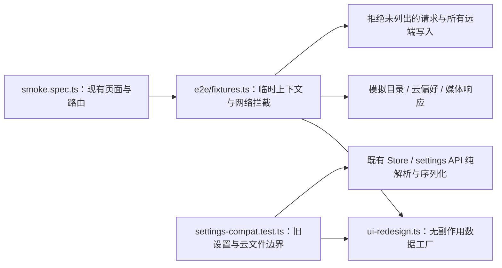

# UI 改造验证数据

T005 建立此目录。数据只用于隔离测试，账户、仓库、SHA、文件名与媒体均为合成样本，Token 为空；不从用户浏览器、环境变量或真实 GitHub 仓库提取数据。

- 仓库 fixture 表示已保存的仓库上下文，`logined: true` 只用于呈现导航，不能证明认证；Token、OAuth code 与认证存储均不填入非空值。
- 目录数据覆盖空目录、仅文件夹、文件夹与直属图片共存，以及含图片 / MP4 的子目录。媒体使用固定小图响应，不下载远程媒体。
- HTTP 失败数据覆盖 401、403、404、409、429 和 503；部分成功数据包含一个 blob 成功、一个 blob 失败，以及 ref 成功 / 失败两种回应。它们供后续 typed request / 逐项上传任务复用，T005 不提前实现结果服务，也不把当前整体布尔值行为固定为正确结果。
- 旧偏好样本缺少 `enableTimestamp`、水印 `rotate / gap`、`management / deploy`，包含原名模式、禁用的旧前缀、编码器、原始 URL 开关、BBCode 选择和自定义链接规则。单测验证现有本地恢复补默认值、UTF-8 云文件解析和云保存仅序列化偏好。
- E2E 使用每个测试独立的 Playwright browser context，阻止 Service Worker 绕过请求拦截；仅放行本地 preview 的 GET / HEAD。GitHub GET 按确定路径返回 fixture，写入和未知请求一律中止并让测试失败，不访问真实 OAuth、仓库或统计 / IP 服务。
- 现阶段 smoke 断言旧 UI 的实际角色与可见内容。P1 / P2 改入口时同步迁移断言，不用 catch-all 页面存在替代目标页验证；不预写尚未实现的新弹窗、搜索和上传结果断言。

运行：先 `pnpm build`，再 `pnpm test:e2e`；单测 `pnpm test`。本机 pnpm 预检 / Chrome 沙箱差异及单次兼容方式见 [P0 验收记录](../../docs/UI-REDESIGN-ACCEPTANCE.md)。这些 fixture 不提供真实认证、远端写入或 Pages 可用性的验收证据。
